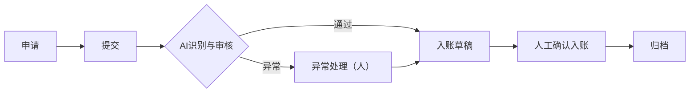

# 《财务共享AI改造流程图》模板

## 一、流程改造表（以费用报销为例，可换成应付）

| 环节 | 现状痛点 | 谁做（AI / RPA工作流 / 人） | 做什么 | 输入 → 输出 | 人工复核点 | 对应指标 |
|---|---|---|---|---|---|---|
| 申请 | | | | | | |
| 提交 | | | | | | |
| AI识别与审核 | | | | | | |
| 异常处理 | | | | | | |
| 入账 | | | | | | |
| 归档 | | | | | | |

## 二、分工原则
- 规则明确的 → 自动化（RPA / 工作流）
- 非结构化识别与解释 → AI
- 例外事项、最终付款与入账确认 → 人工

## 三、Mermaid 流程图骨架（请补全后粘贴到支持Mermaid的工具中查看）

## 四、关键指标清单
| 指标 | 定义与公式 | 方向 | 目标值建议 | 数据来源 | 责任岗位 |
|---|---|---|---|---|---|
| | | | | | |
